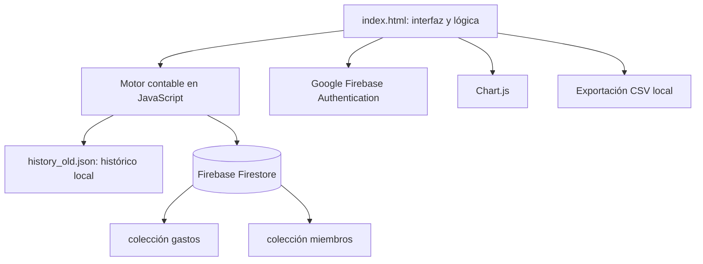

# Contexto técnico y funcional de BING-O 4.0

> Fotografía del proyecto a 23 de noviembre de 2026.
> Rama: `main` · Commit de integración de referencia: `fa3a767`.

Este documento describe la estructura, las reglas contables, las funcionalidades y el estado técnico de la aplicación tal y como existen en el repositorio en la fecha indicada. Su objetivo es permitir retomar el desarrollo sin tener que reconstruir el contexto a partir del código o de conversaciones anteriores.

## 1. Objetivo del producto

BING-O 4.0 es una aplicación web para gestionar las finanzas compartidas de un grupo de personas, siguiendo un modelo similar a Tricount pero basado en saldos globales.

No se almacenan deudas permanentes entre parejas de usuarios. Cada transacción contiene un conjunto de variaciones por miembro y el saldo de cada persona se obtiene acumulando todas sus variaciones:

- Un valor positivo significa que el miembro ha adelantado dinero o ha reducido una deuda.
- Un valor negativo significa que el miembro debe dinero al grupo o ha recuperado parte de lo adelantado.
- Una transacción ordinaria debe sumar exactamente cero.
- La suma de todos los saldos del grupo debería ser cero, salvo descuadres históricos o una transacción MAFTA autorizada.

El proyecto sustituye a una hoja de cálculo donde cada fila era una transacción y las columnas correspondían a los miembros.

## 2. Arquitectura general

La aplicación es un frontend estático. La interfaz y la lógica permanecen concentradas en `index.html`, mientras que los estilos y temas se han extraído a `styles.css`. No existe un backend propio ni un proceso de compilación.



### Tecnologías

- HTML5 y JavaScript vanilla mediante `index.html`.
- CSS y sistema visual mediante `styles.css`.
- Módulos ES cargados directamente en el navegador.
- Tailwind CSS desde CDN.
- Font Awesome desde CDN.
- Google Fonts: Inter y JetBrains Mono.
- Chart.js 4.4.1 desde CDN.
- Firebase JavaScript SDK 11.6.1.
- Google Authentication.
- Cloud Firestore con caché persistente en IndexedDB y soporte multiventana.
- Vercel como alojamiento estático.

### Consecuencias de esta arquitectura

- No hay `package.json`, bundler, servidor propio ni suite automatizada de pruebas.
- La aplicación depende de conexión a los CDN para cargar estilos, iconos, fuentes, gráficas y Firebase.
- La configuración pública de Firebase está incluida en el frontend.
- Las autorizaciones reales deben imponerse con reglas de Firestore; las comprobaciones JavaScript solo controlan la interfaz.

## 3. Estructura del repositorio

| Ruta | Función |
| --- | --- |
| `index.html` | Interfaz, motor contable, autenticación, sincronización y renderizado. |
| `styles.css` | Estilos globales, fuentes locales, variables de los 24 temas y personalizaciones de los temas especiales. |
| `history_old.json` | Histórico importado del Excel. Contiene actualmente 633 transacciones. |
| `resources/icon.svg` | Favicon y Apple Touch Icon. |
| `resources/icon-symbol.svg` | Símbolo reutilizable del logotipo en la cabecera. |
| `resources/title.svg` | Recurso gráfico del título de la aplicación. |
| `resources/fonts/` | Tipografías locales utilizadas por temas normales y especiales. |
| `resources/themes/` | Títulos y fondos de GTA VI, Cyberpunk 2077, Geometry Dash y Resident Evil. |
| `README.md` | Presentación general del proyecto; algunos datos están desactualizados respecto al código. |
| `vercel.json` | Reenvía las rutas `/__/auth/*` al dominio de autenticación de Firebase. |

No hay en el repositorio archivos `firebase.json`, `.firebaserc` ni `firestore.rules`.

## 4. Miembros y grupos

Los miembros iniciales están definidos en `DEFAULT_MEMBERS`.

| ID interno | Nombre inicial | Ticker | GENTES | Administrador |
| --- | --- | --- | --- | --- |
| `alex` | Alex | ALX | Sí | No |
| `luis` | Luis | LYB | Sí | Sí |
| `max` | Martínez | PMD | Sí | No |
| `cabo` | Cabo | JCC | Sí | Sí |
| `emi` | Emi | EMI | Sí | No |
| `por` | Por | POR | No | No |
| `pedro` | Pedro | PED | No | No |
| `asis` | Asis | ASM | No | No |

Cada miembro incluye además:

- Color del avatar.
- Color de su serie en la gráfica.
- Saldo, movimientos y total adelantado de base, actualmente inicializados a cero.
- Opcionalmente un hash SHA-256 del correo de acceso.

El grupo `core`, mostrado como **GENTES**, contiene inicialmente cinco miembros. Los usuarios creados desde Administración se añaden con `core: false` y `admin: false`.

### Nombres y tickers

- El nombre admite hasta 30 caracteres.
- Se permiten letras Unicode, espacios, punto, apóstrofo y guion.
- El ticker debe contener exactamente tres letras mayúsculas de `A` a `Z`.
- No puede haber dos tickers iguales.
- Los tickers son dinámicos: sus cambios se reflejan en saldos, historial, liquidación, gráficas y exportación.

## 5. Modelo de datos

### 5.1 Transacción

Una transacción moderna tiene esta forma conceptual:

```js
{
  id: "tx-<timestamp>-<sufijo>",
  concept: "Cena",
  date: "2026-11-22",
  type: "equal" | "exact" | "bizum" | "mafta",
  deltas: {
    cabo: 30,
    luis: -15,
    alex: -15
  },
  createdAt: 1795300000000,
  userEmail: "correo del usuario autenticado",
  creadoPor: "Nombre visible",
  creadorId: "cabo",
  anulado: false
}
```

Si se registra mediante el permiso excepcional para una transacción MAFTA, también puede contener:

```js
{
  maftaAuthorized: true,
  maftaAuthorizedBy: "cabo",
  maftaImbalance: 0.01
}
```

Las transacciones anuladas conservan además `anuladoPor` y `fechaAnulacion`.

### 5.2 Miembro remoto

Los documentos de `miembros/{memberId}` pueden contener:

```js
{
  name: "Cabo",
  code: "JCC",
  emailHash: "<sha256>",
  core: true,
  admin: true,
  updatedAt: 1795300000000,
  updatedBy: "cabo"
}
```

Los miembros predeterminados se fusionan con los datos remotos. Los miembros adicionales se construyen a partir de los documentos válidos de la colección.

### 5.3 Fuentes de datos

La aplicación combina dos orígenes:

1. `history_old.json`: histórico local e inmutable procedente del Excel. Sus IDs comienzan por `hist-`.
2. Firestore, colección `gastos`: transacciones modernas sincronizadas en tiempo real.

`getAllTransactions()` concatena ambas fuentes. Los cálculos excluyen las transacciones marcadas como anuladas.

La suscripción principal consulta documentos de `gastos` con `createdAt >= 1650000000000`. Si esa consulta falla, se intenta suscribir a toda la colección. En ambos casos se descartan los documentos cuyo ID comienza por `hist-`, para no duplicar el histórico local.

## 6. Motor contable

### Saldo de un miembro

Para cada transacción no anulada se suma `deltas[memberId]` al saldo del miembro.

### Número de transacciones por miembro

Se incrementa una vez por cada transacción en la que el miembro tenga una variación distinta de cero.

### Total adelantado

Es la suma acumulada de todas las variaciones positivas del miembro.

### Crédito en circulación

```text
Crédito = suma(|saldo de cada miembro|) / 2
```

Representa la deuda viva del grupo sin contar dos veces la misma cantidad.

### Error cuadrático medio

```text
ECM = raíz(suma(saldo²) / número de miembros)
```

### Riesgo absoluto

```text
R.A. = raíz(Crédito × ECM)
```

### Riesgo relativo

```text
Riesgo relativo = (R.A. / 144,768)²
```

En Saldos se muestra como porcentaje. Los umbrales visuales actuales son:

- Menos de 15 %: riesgo bajo.
- Entre 15 % y 45 %: riesgo moderado.
- Desde 45 %: alerta de morosidad alta.

### Dinero Generado, D.G.

Es la suma de todos los saldos del grupo. En contabilidad ordinaria debe ser `0,00 €`.

### Precisión

- Los modos normales trabajan en céntimos enteros para evitar errores de coma flotante.
- `formatEuro` muestra como máximo dos decimales y utiliza formato español.
- MAFTA puede conservar temporalmente hasta seis decimales al limpiar residuos históricos inferiores a un céntimo.

## 7. Pantallas principales

La navegación inferior contiene cinco apartados.

### 7.1 Saldos

Funciones actuales:

- Mensaje institucional: “Una aplicación del Banco de Inversión Nacional de Gentes”.
- Indicadores superiores de Crédito en Circulación y Riesgo Relativo.
- Selector entre GENTES y todos los miembros.
- Tarjetas ordenadas por saldo, con nombre, ticker, saldo, barra proporcional y estado:
  - `Acreedor` para saldo positivo.
  - `Deudor` para saldo negativo.
  - `Libre (0,00 €)` para saldo cero.
- No muestra en las tarjetas el total adelantado ni el número de transacciones; esos datos quedan en Estadísticas.
- Bloque **Liquidar deuda**, con una propuesta de pagos mostrada mediante tickers.
- Si todos los saldos están a cero, muestra “No hay deudas pendientes”.
- El botón de corrección MAFTA solo aparece a un administrador cuando el D.G. global está descuadrado al menos medio céntimo.

#### Liquidación de deuda

El algoritmo separa deudores y acreedores, los ordena por importe descendente y va emparejando las cantidades máximas posibles. Cada propuesta contiene:

- ID y ticker del deudor.
- ID y ticker del acreedor.
- Importe del Bizum.

El botón **Liquidar Bizum** abre una confirmación y registra una transacción donde:

- El deudor suma el importe.
- El acreedor resta el importe.

### 7.2 Añadir

Todos los modos comparten asunto, fecha y una vista previa de la transacción. La fecha se inicializa con la fecha local del dispositivo.

Se aceptan fórmulas simples que empiecen por `=`, por ejemplo `=2+3/4`. Solo se admiten números, paréntesis y los operadores `+`, `-`, `*` y `/`. Al salir del campo se muestra el resultado; al volver a enfocarlo reaparece la fórmula original.

#### Partes iguales

- Se elige pagador, importe y participantes.
- El pagador recibe `+importe`.
- Cada participante recibe su parte negativa.
- Si el importe no se divide exactamente, los céntimos sobrantes se distribuyen individualmente.
- El usuario puede rotar quién asume esos céntimos.
- Si el pagador también es participante, su resultado final es la suma algebraica de ambos efectos.

#### Modo manual

Cada miembro puede tener simultáneamente:

- Un importe numérico positivo, negativo o cero.
- El botón `P`, para participar en un reparto positivo.
- El botón `X`, para participar en un reparto negativo.

Reglas implementadas:

- Sin `P` ni `X`: los importes numéricos deben sumar cero.
- Solo `X`: el saldo neto numérico, que debe ser positivo o cero, se reparte negativamente entre las `X`.
- Solo `P`: el valor pendiente, cuya suma numérica debe ser negativa o cero, se reparte positivamente entre las `P`.
- `P` y `X` presentes: se hacen dos repartos independientes. Los importes negativos se compensan positivamente entre las `P`, y los positivos se compensan negativamente entre las `X`.
- Los ajustes se acumulan con el importe numérico del propio participante.
- Los céntimos no divisibles se asignan en el orden de los miembros implicados.
- Si el resultado final no suma cero, se impide guardar salvo autorización MAFTA.

#### Bizum

- Se elige deudor, acreedor e importe.
- El deudor que envía recibe una variación positiva.
- El acreedor que recibe obtiene una variación negativa.
- Emisor y receptor deben ser distintos.

#### Validaciones comunes

- La fecha es obligatoria.
- En gastos ordinarios, el asunto es obligatorio.
- Un Bizum sin asunto genera automáticamente uno con los nombres de los participantes.
- Debe existir al menos una variación de 0,005 € o más.
- La suma debe redondear a cero céntimos, salvo MAFTA.
- La confirmación ordinaria muestra el concepto, sin incluir D.G.

La ausencia de fecha abre el modal humorístico asociado a la “fila 436”.

### 7.3 Historial

- Une el histórico del Excel y las transacciones modernas.
- Ordena por `createdAt` y muestra primero las más recientes.
- Permite buscar por asunto o fecha.
- Permite filtrar por miembro.
- Los importes por miembro se identifican mediante tickers.
- Las filas históricas se marcan como `Excel v3.2` y no se pueden anular desde la interfaz.
- Las transacciones modernas muestran su creador.
- Las transacciones modernas se pueden anular y restaurar.
- La anulación es lógica: el documento no se borra de Firestore.
- Una transacción anulada deja de participar en todos los cálculos.
- Se puede exportar el histórico completo a CSV compatible con Excel.

#### Exportación CSV

- Codificación UTF-8 con BOM.
- Separador `;`.
- Decimales con coma.
- Columnas: número, asunto, un campo por ticker, fecha y estado.
- Incluye transacciones históricas, modernas y anuladas.
- El nombre sigue el patrón `BINGO_4.0_Export_AAAA-MM-DD.csv`.

### 7.4 Estadísticas

Indicadores mostrados:

- Crédito en Circulación.
- Error Cuadrático Medio.
- Riesgo Absoluto.
- Riesgo Relativo.
- Volumen Total Movido.
- Dinero Generado.

La tabla por miembro muestra:

- Miembro.
- Saldo.
- `N.º`, correspondiente al número de transacciones en las que participa.
- Total adelantado.

La gráfica histórica contiene:

- Una serie por miembro, identificada por ticker.
- Una serie discontinua para el Crédito.
- Filtro entre todos los miembros y GENTES.
- Posibilidad de ocultar series desde la leyenda.
- Tooltip con fecha, concepto y valores.
- Colores adaptados al tema claro u oscuro.

### 7.5 Administrar

#### Administrar usuario

Visible para cualquier miembro autenticado:

- Editar su nombre.
- Editar su ticker.
- Validar nombre, formato del ticker y unicidad.

#### Administrador autorizado

Visible solo si `activeMember.admin === true`:

- Editar el nombre y ticker de cualquier miembro.
- Crear un usuario nuevo con nombre, ticker y correo de acceso.
- Habilitar una transacción MAFTA excepcional.

Los administradores predeterminados son Luis y Cabo.

La interfaz no ofrece actualmente una opción para conceder o retirar el rol de administrador. El campo remoto `admin` sí se lee desde Firestore.

## 8. Protocolo MAFTA

MAFTA significa **Movimiento Autorizado de Fondos por Transacción Arbitraria**. Existen dos flujos relacionados pero distintos.

### 8.1 Transacción arbitraria autorizada

Un administrador puede habilitar una única transacción que no sume cero:

- La interfaz cambia al modo manual.
- Aparece un aviso con una casilla para aplicar la autorización.
- La transacción se marca con los campos `maftaAuthorized`, `maftaAuthorizedBy` y `maftaImbalance`.
- La autorización se consume al guardar correctamente esa transacción.

### 8.2 Corrección del descuadre global

Si el D.G. acumulado no es cero:

1. Se eliminan los residuos inferiores al céntimo de todos los miembros.
2. El descuadre restante se convierte a céntimos.
3. Se reparte entre los miembros de GENTES.
4. El orden de reparto prioriza al más acreedor o al más deudor según el signo del ajuste.
5. Se registra una transacción de tipo `mafta`.

Solo un administrador autorizado puede ejecutar cualquiera de estos flujos.

## 9. Autenticación, identidad y permisos

### Inicio de sesión

- Se usa Google mediante Firebase Authentication.
- Se intenta abrir un popup.
- En entornos que bloquean el popup se usa redirección.
- En móvil, el botón superior se comprime y muestra únicamente el icono o avatar, igual que Añadir y Temas.

### Asociación entre Google y miembro

- El correo autenticado se normaliza y se convierte a SHA-256 en el navegador.
- El hash se compara con `MEMBER_EMAIL_HASHES` y con los `emailHash` cargados desde Firestore.
- El correo completo no se incluye en la tabla estática de miembros.
- Si el hash no corresponde a ningún miembro, se cierra la sesión.

### Límites de esta protección

- La lista de hashes y el indicador `admin` se evalúan en el cliente.
- Esto controla qué opciones presenta la interfaz, pero no sustituye a las reglas de Firestore.
- Las reglas del servidor deben comprobar de forma independiente quién puede leer o modificar `gastos` y `miembros`.

### Anulación y restauración

La interfaz exige estar autenticado, pero no limita la operación al creador de la transacción ni a un administrador. La política definitiva debe depender de las reglas de Firestore.

## 10. Firestore

Proyecto configurado: `bing-o-95a98`.

### Colección `gastos`

Se usa para:

- Crear transacciones.
- Sincronizarlas en tiempo real.
- Marcar transacciones como anuladas.
- Restaurarlas.

### Colección `miembros`

Se usa para:

- Sobrescribir nombre y ticker de miembros predeterminados.
- Cargar roles y hashes de acceso.
- Crear miembros adicionales.

### Problema conocido: no se guardan cambios de usuario

La interfaz muestra “No se pudieron guardar los cambios del usuario” cuando `setDoc` falla al escribir en `miembros/{memberId}`.

El repositorio no contiene reglas de Firestore ni configuración de despliegue para esa colección. La causa más probable es que las reglas desplegadas permiten las operaciones existentes sobre `gastos`, pero no las nuevas escrituras sobre `miembros`.

No debe solucionarse con una regla genérica que permita a cualquier usuario autenticado modificar cualquier perfil. La solución segura requiere:

1. Obtener las reglas actualmente desplegadas.
2. Establecer una asociación verificable en servidor entre `request.auth.uid` y el miembro.
3. Permitir que un usuario modifique únicamente los campos autorizados de su propio perfil.
4. Permitir la gestión global solo a UIDs o claims administrativos.
5. Proteger `admin`, `emailHash`, `core` y cualquier campo de identidad frente a escaladas de privilegios.
6. Versionar y desplegar las reglas junto con el repositorio.

## 11. Sincronización y funcionamiento sin conexión

- Firestore se inicializa con caché local persistente.
- Se usa un gestor multiventana para coordinar varias pestañas.
- El histórico del Excel siempre se carga desde el archivo JSON local.
- El indicador `EN LÍNEA` representa que Firebase se inicializó, no garantiza por sí solo que todas las lecturas y escrituras estén autorizadas.
- Las actualizaciones de transacciones se reflejan primero en memoria y después se intenta escribir en Firestore.

Riesgo conocido: si falla el guardado de una transacción, el elemento añadido de forma optimista no se elimina inmediatamente de `dynamicTransactions`. Una recarga o una nueva instantánea de Firestore corrige el estado, pero hasta entonces la vista puede mostrar una operación no persistida. Las anulaciones y restauraciones siguen un patrón optimista similar.

## 12. Temas y diseño adaptable

Hay 24 temas:

- Oscuros: BING-O Clásico, OLED Negro, Nord, Drácula, Gruvbox, Rosé Pine, Solarized Dark, Porcelain Dark, Arctic Dark y Graphite Dark.
- Claros: Claro, Sepia, Latte, Menta, Sakura, Solarized, Porcelain, Graphite, Nord y Arctic.
- Especiales: GTA VI, Cyberpunk 2077, Geometry Dash y Resident Evil.

El tema se aplica mediante variables CSS, se guarda en `localStorage` con la clave `bingo_theme` y actualiza:

- Colores de la interfaz.
- Clase claro/oscuro del documento.
- `theme-color` del navegador.
- Colores y renderizado de la gráfica.
- Logotipo de cabecera, fuentes, fondos y tratamientos visuales propios en los temas especiales.

La aplicación está diseñada principalmente para móvil:

- Ancho máximo del contenido: `2xl` de Tailwind.
- Navegación fija inferior con cinco pestañas.
- Cabecera fija.
- En anchuras inferiores a `sm` se ocultan los textos de Iniciar sesión, Añadir y Temas.
- Tablas y formularios adaptan columnas o permiten desplazamiento horizontal.

Aunque contiene metadatos para uso móvil y Apple Web App, no hay actualmente `manifest.webmanifest` ni service worker en el repositorio.

## 13. Modales y mensajes auxiliares

La aplicación incluye:

- Modal de fecha ausente o “fila 436”.
- Confirmación para aplicar la corrección MAFTA.
- Confirmación de liquidación rápida por Bizum.
- Inicio de sesión con Google.
- Información de la sesión y cierre de sesión.
- Selector de temas.
- Toasts de éxito y error con cierre automático tras 3,2 segundos.

## 14. Flujo de arranque

Al producirse `DOMContentLoaded`:

1. Se recupera y aplica el tema guardado.
2. Se inicializan selectores y fecha.
3. Se renderizan las vistas con el estado disponible.
4. Se carga `history_old.json`.
5. Se inicializa Firebase.
6. Se activa la caché persistente.
7. Se suscribe a `miembros`.
8. Se inicia el listener de autenticación.
9. Se suscribe a `gastos`.

Cada cambio relevante llama a `refreshAllViews()`, que recalcula el estado completo y vuelve a renderizar Saldos, Historial, Estadísticas y la vista previa activa.

## 15. Limitaciones y deuda técnica conocida

- Falta versionar y desplegar reglas seguras de Firestore.
- La edición y creación de miembros no funciona si `miembros` no está autorizada en Firestore.
- El modelo de autorización del cliente se basa en hashes de correo; las reglas del servidor necesitan una asociación por UID o claims.
- No hay pruebas automatizadas para las reglas contables P/X, reparto de céntimos, MAFTA o permisos.
- No hay herramienta de lint, validación HTML ni compilación.
- `index.html` todavía concentra marcado, estado, persistencia y lógica de negocio; convendría modularizarlo. Los estilos ya están separados en `styles.css`.
- Las dependencias JavaScript y varios recursos base siguen cargándose desde CDN sin un gestor de paquetes, aunque las fuentes y recursos de los temas especiales ya se alojan localmente.
- El histórico real tiene 633 transacciones, mientras que comentarios y README todavía mencionan 628.
- El indicador de conexión no distingue entre inicialización correcta y permisos insuficientes.
- El guardado optimista de gastos no revierte la copia local si Firestore rechaza la escritura.
- Las operaciones de anular y restaurar tampoco restauran automáticamente el estado local ante un fallo remoto.
- Cualquier usuario autenticado ve en el frontend las opciones de anulación de transacciones modernas; la seguridad depende de Firestore.
- No existe desde la interfaz una gestión del rol administrador ni del grupo `core`.
- No hay manifiesto ni service worker para una PWA completamente instalable y con recursos offline.

## 16. Recomendaciones para la siguiente fase

Prioridad sugerida:

1. Recuperar, versionar y endurecer las reglas de Firestore.
2. Definir la identidad del miembro mediante UID y una estrategia segura para administradores.
3. Corregir el rollback de escrituras optimistas fallidas.
4. Añadir pruebas unitarias al motor contable, especialmente P/X y distribución de céntimos.
5. Separar motor contable, persistencia, autenticación y vistas en módulos.
6. Actualizar README y comentarios con las 633 transacciones reales y la terminología actual.
7. Añadir validación automatizada y una prueba básica de navegación móvil.
8. Valorar un manifiesto y service worker si se desea una PWA instalable real.

## 17. Principios que deben conservarse

- Los saldos se calculan globalmente, no como una red permanente de deudas individuales.
- Toda transacción ordinaria debe sumar cero al céntimo.
- Los importes positivos y negativos mantienen su significado contable actual.
- El histórico no se elimina físicamente.
- Las transacciones históricas del Excel permanecen inmutables.
- Los tickers son identificadores visuales de tres letras y deben seguir siendo dinámicos.
- MAFTA es una excepción explícita, temporal, trazable y reservada a administradores.
- La seguridad efectiva debe residir en Firebase, no solo en los controles visuales del navegador.

